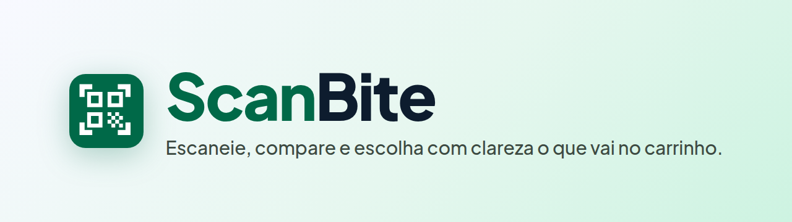
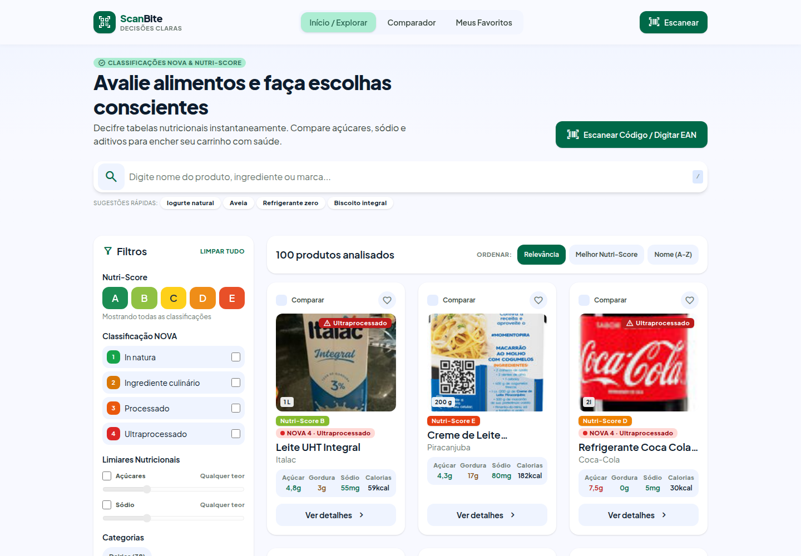
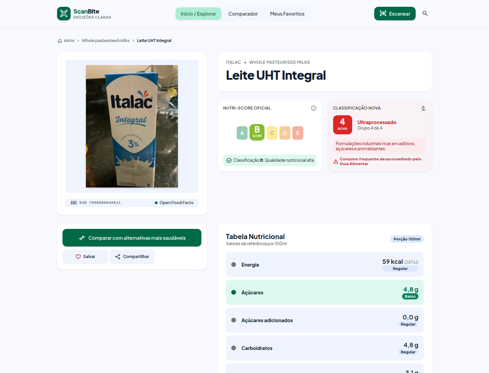
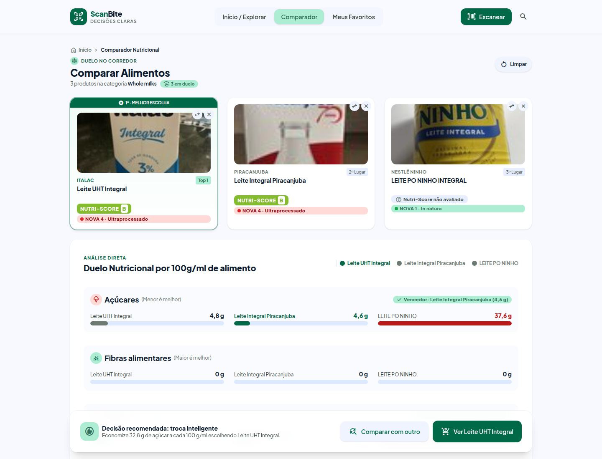
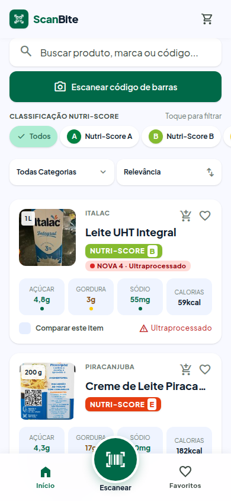
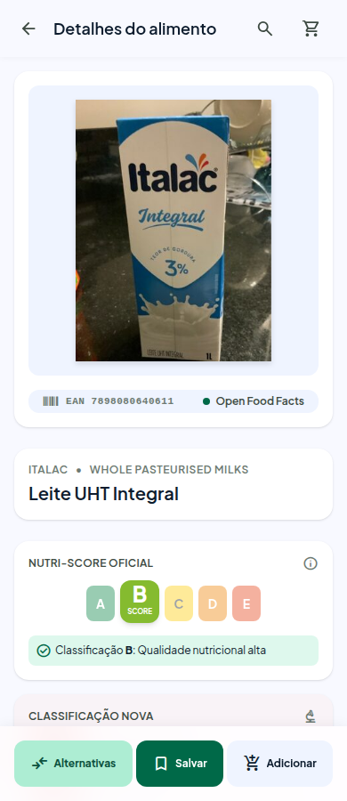

<div align="center">



<br />


**[🌐 Aplicação publicada](https://scanbite-blush.vercel.app)** · **[📦 Repositório](https://github.com/hullick/Desafio-Kodie-2)** · **[✨ Funcionalidades](#-funcionalidades)** · **[🚀 Como executar](#-como-executar)** · **[🤖 Uso de IA](#-uso-de-inteligência-artificial)**

</div>

---

## 📑 Sumário

- [Sobre o projeto](#-sobre-o-projeto)
- [Demonstração](#-demonstração)
- [Funcionalidades](#-funcionalidades)
- [Comportamentos da aplicação](#-comportamentos-da-aplicação)
- [API utilizada](#-api-utilizada)
- [Tecnologias](#-tecnologias)
- [Arquitetura e componentização](#-arquitetura-e-componentização)
- [Como executar](#-como-executar)
- [Aplicação publicada](#-aplicação-publicada)
- [Uso de Inteligência Artificial](#-uso-de-inteligência-artificial)
- [Privacidade e limites](#-privacidade-e-limites)
- [Créditos](#-créditos)

---

## 💡 Sobre o projeto

**ScanBite** é um painel interativo que transforma os dados abertos da [Open Food Facts](https://world.openfoodfacts.org) em uma consulta rápida e clara dos produtos que a pessoa encontra no supermercado.

### Problemática

> Como transformar dados disponibilizados por uma API pública em uma aplicação que facilite a consulta e a interação do usuário com essas informações?

No mercado, ler e comparar rótulos é lento e difícil de interpretar: são dezenas de números por produto, em unidades diferentes, e o que importa (muito açúcar? muito sódio? é ultraprocessado?) fica escondido no meio da tabela. A Open Food Facts tem esses dados, mas **ter acesso aos dados não significa que eles sejam fáceis de entender**.

### Objetivo

Dar acesso **rápido e intuitivo** às informações nutricionais de produtos vendidos no Brasil e mostrar, de imediato, **quais alertas cada produto traz** (por exemplo, alto em açúcar ou em sódio), sem dar conselho médico: os alertas são informativos.

### Para quem é

| | |
|---|---|
| **Público principal** | Consumidores de 30 a 50 anos |
| **Contexto de uso** | No celular, dentro do mercado (escaneando o produto), e no computador, para tirar dúvidas depois |
| **Função central** | O **detalhamento do produto**: os dados exibidos batem com os da API e os alertas seguem os limites oficiais |

### Do problema à interface

O projeto seguiu o planejamento pedido no desafio, registrado no [`SPEC.md`](SPEC.md) antes de escrever o código:

```
Problemática → Usuário → Requisitos → API → Dados → Arquitetura → Componentes → Interface
```

---

## 🖼️ Demonstração

### Desktop

| Início e busca | Detalhes do produto |
|---|---|
|  |  |

**Comparador (3 produtos lado a lado)**



### Celular

| Início e busca | Detalhes do produto |
|---|---|
|  |  |

> As capturas foram feitas com o app em execução, consumindo a API de testes da Open Food Facts.

---

## ✨ Funcionalidades

### 🔎 Encontrar produtos
- **Busca por nome, marca ou ingrediente**, com sugestões rápidas. Só dispara por ação explícita (Enter ou botão), nunca a cada tecla, para respeitar o limite da API.
- **Somente produtos vendidos no Brasil** nas buscas e listagens.
- **Filtros combináveis**: Nutri-Score (A a E), classificação NOVA (1 a 4), categoria e limiares de **açúcares** e **sódio**.
- **Ordenação** por relevância, melhor Nutri-Score ou nome (A-Z), com **paginação**.

### 📋 Entender um produto
- **Detalhamento completo**: foto, nome, marca, quantidade, **Nutri-Score** e **grupo NOVA** com explicação.
- **Tabela nutricional por 100 g/ml**, com semáforo (baixo, regular, alto) para açúcares, gordura, gordura saturada e sódio.
- **Ingredientes, alérgenos e aditivos**, e alertas de “alto em” conforme a ANVISA.
- **Alternativas mais saudáveis** na mesma categoria.
- Campo sem dado na API **não é exibido** (ou aparece como “Não informado”): o app não inventa valores.

### ⚖️ Comparar
- **Comparador de 2 a 5 produtos** lado a lado, com ranking, **destaque do melhor valor em cada nutriente** e recomendação de troca (“Economize X g de açúcar a cada 100 g”).
- Os produtos comparados ficam na URL (`/comparar?ids=...`), então a comparação pode ser compartilhada.

### ❤️ Organizar
- **Favoritos** salvos no aparelho, com **“nota da despensa”** (média de Nutri-Score da lista), diagnóstico e alertas da lista.
- **Checklist de mercado** (mobile): carrinho com itens marcáveis, que abre mesmo sem internet.
- **Exportar a lista** em PDF (impressão do navegador) ou **enviar por WhatsApp**.

### 📷 Escanear
- **Leitura do código de barras pela câmera** (nativa do navegador quando disponível; senão ZXing em WebAssembly).
- **Digitação manual** do código (com validação do dígito verificador) como alternativa.
- **Histórico de escaneamentos recentes**.

### 📱 Interface
- **Responsiva** para celular, tablet e desktop, com navegação própria para cada contexto (barra de abas inferior no celular e menu no topo no desktop).
- Páginas **Sobre** (metodologia: o que é Nutri-Score, NOVA, semáforo) e **Privacidade**.

---

## 🧭 Comportamentos da aplicação

O desafio pede para pensar em **“o que pode acontecer quando o usuário utilizar a aplicação”**. Cada situação abaixo tem uma resposta de interface própria:

| Situação | O que o usuário vê |
|---|---|
| **Carregando** | Esqueletos (*skeletons*) no formato dos cards, em vez de tela vazia |
| **Busca sem resultado** | Mensagem explicando que nada foi encontrado e como seguir |
| **Produto não encontrado** (código inexistente) | Tela 404 própria, com opção de buscar ou **cadastrar o produto na Open Food Facts** |
| **API instável (503/502/504/429)** | Novas tentativas automáticas com espera crescente; se persistir, tela de erro com “tentar de novo” e monitor do serviço |
| **Sem internet** | Tela de “sem conexão” com dicas e botão para tentar de novo; o **checklist de mercado** continua abrindo, pois guarda os dados no aparelho |
| **Câmera negada ou indisponível** | Tela com passo a passo para liberar a permissão e alternativa por digitação |
| **Produto sem Nutri-Score ou sem foto** | Exibição própria, sem quebrar o layout |
| **Rota inexistente** | Página 404 |

---

## 🔌 API utilizada

**[Open Food Facts](https://world.openfoodfacts.org)**: base aberta e colaborativa de produtos alimentícios. É gratuita, **sem chave de API** para leitura, e tem **CORS liberado**, então o app chama a API direto do navegador, sem back-end.

| Uso no app | Endpoint |
|---|---|
| Produto por código (detalhes, scanner, digitação) | `GET /api/v3/product/{codigo}` |
| Busca por texto | `GET /cgi/search.pl?search_terms=...&json=1` |
| Navegar só por filtros (categoria, Nutri-Score, NOVA) | `GET /api/v2/search?countries_tags_en=brazil&...` |
| Vários produtos de uma vez (comparador, favoritos) | `GET /api/v2/search?code=a,b,c` |
| Alternativas mais saudáveis | `GET /api/v2/search?categories_tags_en=...&nutrition_grades_tags=...` |

**Campos usados:** `code`, `product_name`, `brands`, `quantity`, `image_front_url`, `nutriscore_grade`, `nova_group`, `nutriments` (valores por 100 g), `nutrient_levels`, `additives_tags`, `allergens_tags`, `ingredients_text`, `categories_tags`.

### Como o app respeita os limites da API

A Open Food Facts limita o uso (**15 leituras/min** e **10 buscas/min por IP**) e pode responder 503 quando há excesso. Por isso o app tem:

- **Limitador no navegador** com margem de segurança (12 leituras e 8 buscas por minuto): chamadas além do limite esperam a vez em vez de tomarem erro.
- **Cache de respostas** (memória + `sessionStorage`/`localStorage`, validade de 15 minutos): repetir uma consulta não gasta requisição, e produtos vindos de uma busca já entram no cache para o detalhe abrir instantaneamente.
- **Uma requisição só** para comparar até 5 produtos (`code=a,b,c`), apenas dos que ainda não estão no cache.
- **Novas tentativas** (até 2) com espera crescente e respeito ao cabeçalho `Retry-After`.
- **Conversão de unidades**: a API devolve o sódio em gramas e a legislação usa miligramas; o app converte antes de exibir.

---

## 🛠️ Tecnologias

| Camada | Tecnologia |
|---|---|
| Interface | [React 19](https://react.dev) |
| Build e dev server | [Vite 8](https://vite.dev) |
| Linguagem | [TypeScript](https://www.typescriptlang.org) |
| Estilos | [Tailwind CSS 4](https://tailwindcss.com), com *design tokens* próprios (paleta, tipografia e espaçamento) |
| Rotas | [React Router](https://reactrouter.com) |
| Leitor de código de barras | [zxing-wasm](https://github.com/Sec-ant/zxing-wasm) (+ `BarcodeDetector` nativo quando existe) |
| Lint | [Oxlint](https://oxc.rs) |
| Fonte e ícones | Plus Jakarta Sans e Material Symbols (Google Fonts) |

Persistência apenas no navegador (`localStorage`): **sem back-end e sem login**.

---

## 🧩 Arquitetura e componentização

Os componentes seguem **Atomic Design**, cada nível com responsabilidade clara:

```
src/
├── components/
│   ├── atoms/        # menores peças, sem regra de negócio (Button, Icon, Logo, BadgeNutriScore…)
│   ├── molecules/    # composições simples (NutrientTile, SearchBarGlobal, Pagination…)
│   ├── organisms/    # blocos completos da interface (ProductGrid, FilterPanel, ComparisonFullTable…)
│   └── templates/    # esqueleto de página (PageTemplate, InfoPage)
├── pages/            # uma por rota (Home, ProductDetails, Compare, Favorites, Scanner, erros…)
├── hooks/            # estado e comportamento (useProductSearch, useFavorites, useBarcodeScanner…)
├── services/         # acesso à API: cliente HTTP, cache, limitador, tratamento de erros
├── models/           # tipos e conversão do JSON da API para o formato do app
├── lib/              # funções puras (nota de saúde, comparação, paginação, código de barras…)
├── config/           # constantes (navegação, categorias, limiares ANVISA, busca)
└── i18n/             # nomes de categorias traduzidos
```

**Decisões que valem destacar**

- **Separação entre API e interface:** a resposta crua da Open Food Facts é convertida em `models/` num formato próprio; as telas nunca leem o JSON da API diretamente. Se a API mudar, o ajuste fica em um lugar só.
- **Regras em funções puras (`lib/`)**, separadas dos componentes, o que facilita conferir se os alertas e a comparação estão corretos.
- **Estado compartilhado sem biblioteca externa:** favoritos, comparação e checklist usam um *store* mínimo sobre `localStorage` + `useSyncExternalStore`, sincronizado entre abas.
- **Rotas por funcionalidade**, incluindo as de erro (`/erro`, `/sem-conexao`, `/scanner/camera-negada`).
- **Nomes de categorias em português:** um script gera, a partir da taxonomia oficial, o arquivo de nomes por idioma, baixado só para o idioma da pessoa.

---

## 🚀 Como executar

### Pré-requisitos

- **Node.js** `^20.19` ou `>=22.12` (exigência do Vite 8) e **npm**
- Conexão com a internet (API e geração dos nomes de categorias)

### Passo a passo

```bash
# 1. Clone o repositório
git clone https://github.com/hullick/Desafio-Kodie-2.git
cd Desafio-Kodie-2

# 2. Instale as dependências
npm install

# 3. Configure a variável de ambiente
cp .env.example .env.development

# 4. Rode em modo de desenvolvimento
npm run dev
```

Abra **http://localhost:5173**.

### Variáveis de ambiente

| Variável | Obrigatória | Descrição |
|---|---|---|
| `VITE_OFF_BASE_URL` | **Sim** | Endereço da API. Produção: `https://world.openfoodfacts.org`. Desenvolvimento e testes: `https://world.openfoodfacts.net` (ambiente de testes, com cota separada, então testar não bloqueia o IP na API real) |
| `VITE_SUPPORT_URL` | Não | Link para abertura de *issues*, usado no rodapé e nas páginas Sobre e Privacidade |

> O projeto **recusa iniciar** sem as variáveis obrigatórias e avisa qual está faltando, em vez de quebrar só na primeira requisição.

### Scripts

| Comando | O que faz |
|---|---|
| `npm run dev` | Servidor de desenvolvimento com recarga automática |
| `npm run build` | Verifica os tipos e gera a versão de produção em `dist/` |
| `npm run preview` | Serve localmente o build de produção |
| `npm run lint` | Roda o Oxlint |
| `npm run i18n:categories` | Regenera os nomes das categorias por idioma |

> **Câmera:** o navegador só libera a câmera em `https://` ou em `localhost`. Para testar o scanner no celular durante o desenvolvimento, use um túnel HTTPS.

---

## 🌐 Aplicação publicada

**🔗 [scanbite-blush.vercel.app](https://scanbite-blush.vercel.app)**

> A Open Food Facts é gratuita e mantida por voluntários, e às vezes responde **503** (instabilidade ou excesso de consultas). Nesse caso o app mostra a tela de erro com o botão “Tentar novamente”: aguarde alguns instantes e tente de novo.

Publicação na **Vercel** ou **Netlify**:

1. Importe o repositório do GitHub (o provedor detecta o Vite automaticamente).
2. **Build command:** `npm run build` · **Output directory:** `dist`
3. Em *Environment Variables*, defina `VITE_OFF_BASE_URL=https://world.openfoodfacts.org` (e, se quiser, `VITE_SUPPORT_URL`).
4. O app usa rotas no navegador (`/produto/...`, `/comparar`): o repositório inclui `vercel.json` e `public/_redirects` para que recarregar a página numa rota interna não dê 404.

---

## 🤖 Uso de Inteligência Artificial

A IA foi usada de forma **intensa e declarada** neste projeto, em duas ferramentas: o **Google Stitch**, para desenhar as telas, e o **Claude Code** (Anthropic), para planejamento, código e correções. Os commits feitos com o Claude Code trazem a marcação `Co-Authored-By` no histórico do Git.

### Onde a IA foi usada

| Etapa | Ferramenta | Como foi usada |
|---|---|---|
| **Entender o desafio e escolher a API** | Claude Code | Resumo do enunciado, busca de APIs gratuitas da área da saúde e exploração do que a Open Food Facts permite (filtrar produtos brasileiros, limites de uso) |
| **Planejamento (*spec-driven development*)** | Claude Code | Questionário para montar o [`SPEC.md`](SPEC.md): eu respondi as perguntas e a IA organizou e documentou as respostas |
| **Design das telas** | Google Stitch | Montei as telas (início, detalhes, comparador, favoritos, scanner e estados de erro) a partir de uma descrição do projeto gerada com ajuda da IA |
| **Componentização** | Claude Code | Quebrou as telas do design em componentes pequenos, seguindo Atomic Design (átomos, moléculas, organismos e templates) |
| **Dados e requisições** | Claude Code | Montou os modelos TypeScript, mapeou todas as requisições da API e implementou a camada de serviço (cache, limitador e novas tentativas) |
| **Integração com as telas** | Claude Code | Trocou os dados de exemplo pelos dados reais, e implementou favoritos, comparador, checklist e scanner |
| **Correção de problemas** | Claude Code | Investigação de bugs (por exemplo, produto sempre “não encontrado”, scanner que não lia o código, alternativas que não apareciam) |

### Decisões que foram minhas

A IA executou, mas as escolhas de produto e de arquitetura foram tomadas por mim, a partir do que eu queria resolver:

- **Tema e público:** alertas nutricionais para quem compra no mercado pelo celular, e a escolha da Open Food Facts como API.
- **Técnica de planejamento:** adotar *spec-driven development* e documentar antes de implementar.
- **Nome** (ScanBite) e **Tailwind em vez de Bootstrap**.
- **Só produtos vendidos no Brasil** como padrão.
- **Estratégia contra o limite da API:** buscar 100 produtos de uma vez, guardar em cache por 15 minutos e não consultar de novo ao navegar; usar o ambiente de testes no desenvolvimento, com a URL da API em variável de ambiente.
- **Categorias traduzidas** por um arquivo de idiomas gerado no build, baixado só para o idioma da pessoa.
- **Checklist de mercado só no mobile**, com carrinho nos cards e menu inferior com destaque para o scanner.
- **Persistência local** dos produtos comparados, dos favoritos e do carrinho.

### Prompts utilizados

#### 1. Descrição do projeto para o Google Stitch

**Prompt utilizado**

> “Me dê uma descrição do projeto que temos para que eu jogue no stich e ver o que sai”

**Objetivo**

Obter um texto descrevendo o projeto (tema, usuário, telas e estilo) para colar no Google Stitch e gerar o design das telas, já que eu queria uma interface melhor do que a IA de código costuma entregar.

#### 2. Questionário para montar a especificação

**Prompt utilizado**

> “Ok, vamos para as perguntas para montar a spec. Aja como um especialista em spec driven development e monte um questionário para que eu vá respondendo sobre a tarefa central”

**Objetivo**

Seguir o planejamento que o desafio pede (problemática → usuário → requisitos → API → dados) antes de escrever código. Respondi às perguntas e o resultado virou o [`SPEC.md`](SPEC.md).

#### 3. Quebrar as telas em componentes

**Prompt utilizado**

> “Agora eu quero que, baseado nesse texto, voce façca o que se pede.” *(seguido do texto com a proposta de separação em Atomic Design, que colei no prompt)*

**Objetivo**

Transformar as telas do design em uma biblioteca de componentes pequenos e reutilizáveis (átomos, moléculas, organismos e templates) com responsabilidades claras.

#### 4. Modelos e camada de serviço

**Prompt utilizado**

> “Agora vamos para a estrutura de dados, monte classes em typescript que representem os dados vindos da api da openfood”
>
> “commite e siga para a camada de serviço, vamos identificar todas as requisições”

**Objetivo**

Definir o formato dos dados da API e mapear, antes de integrar, todas as requisições que o app precisa fazer (produto por código, busca por texto, filtros e comparação).

#### 5. Cache contra o erro 503

**Prompt utilizado**

> “Preciso de um mecanismo de cache para que evitemos tomar 503 constantemente. Quero saber se a requisiçao para a openfoodfacts tem algum cabeçalho que indique quando o 503 terminará”

**Objetivo**

Entender o limite de uso da API e construir cache, limitador e novas tentativas (respeitando `Retry-After`) para que o app não fique fora do ar para o usuário.

### Como eu me responsabilizo pelo código

Parte do código foi escrita pelo Claude Code a partir das minhas instruções. Por isso, o que garante que o projeto é meu é saber **explicar o que está nele**: os fluxos de dados (API → `services/` → `models/` → telas), as regras de alerta nutricional e as decisões listadas acima. O projeto passa na verificação de tipos (`tsc`) e cada funcionalidade foi testada por mim no navegador durante o desenvolvimento.

---

## 🔒 Privacidade e limites

- **Sem conta e sem back-end.** Favoritos, comparação, checklist, histórico e cache ficam apenas no `localStorage`/`sessionStorage` do seu navegador e nunca são enviados a um servidor do ScanBite.
- A **câmera** é usada só para ler o código de barras, e as imagens não são gravadas nem enviadas.
- **Não é conselho médico.** Os alertas são informativos, baseados em limites oficiais e na classificação da Open Food Facts. Em caso de condição de saúde, consulte um profissional.
- **A qualidade dos dados depende da comunidade.** A Open Food Facts é colaborativa: se achar um erro, corrija-o lá e o dado melhora para todo mundo.
- A busca por texto mostra **só produtos vendidos no Brasil**, mas ao abrir um produto direto pelo código de barras ele pode ser de outro país.

---

## 🙌 Créditos

- Dados: [**Open Food Facts**](https://world.openfoodfacts.org), licença [ODbL](https://opendatacommons.org/licenses/odbl/1-0/) (os dados são abertos e colaborativos).
- Ícones: [Material Symbols](https://fonts.google.com/icons) · Fonte: [Plus Jakarta Sans](https://fonts.google.com/specimen/Plus+Jakarta+Sans).
- Projeto desenvolvido como **Desafio 02: Painel Interativo com API Pública (React + Vite)**.

<div align="center">


**ScanBite** · Decisões claras

</div>
